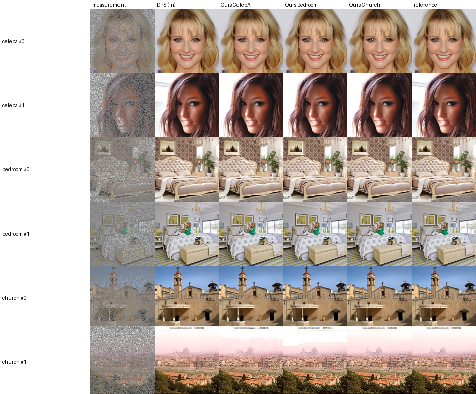
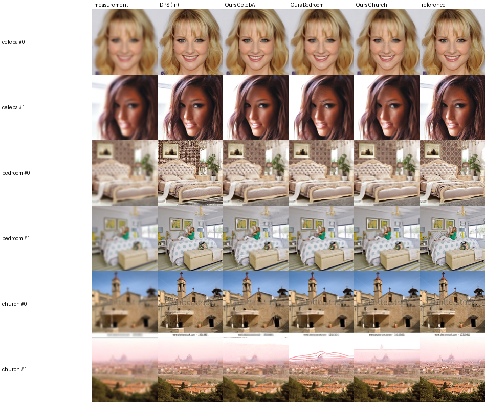
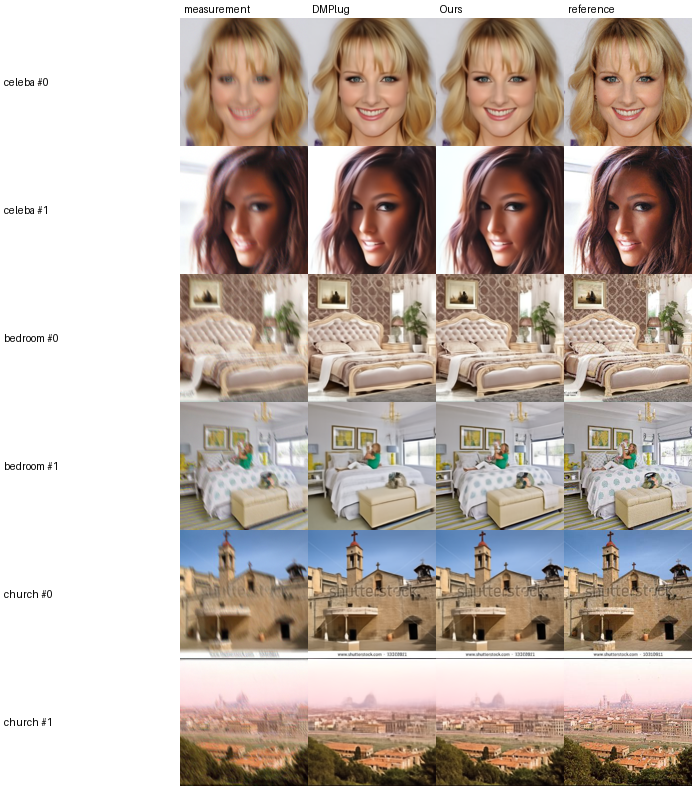
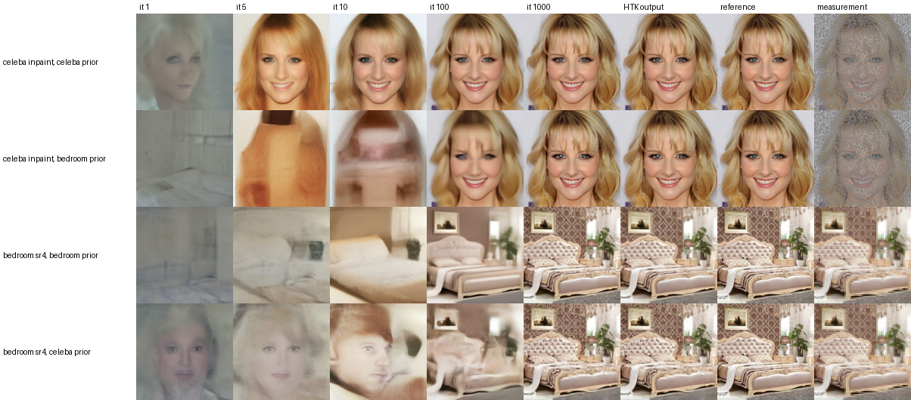
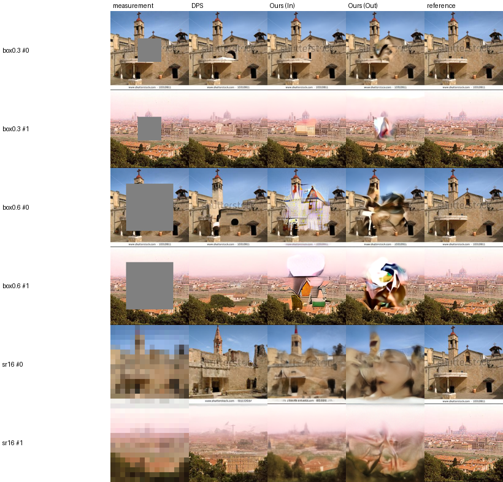
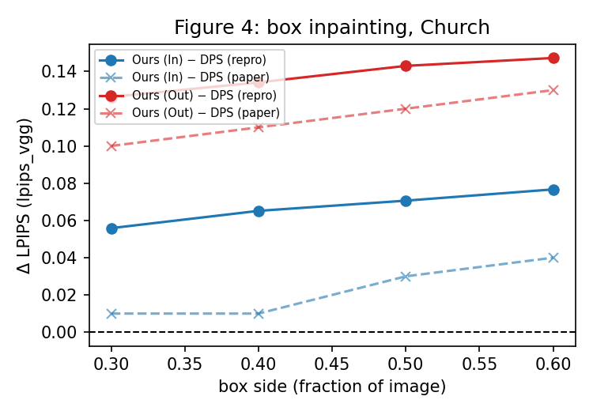
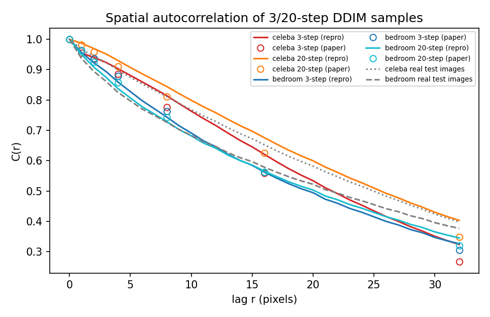
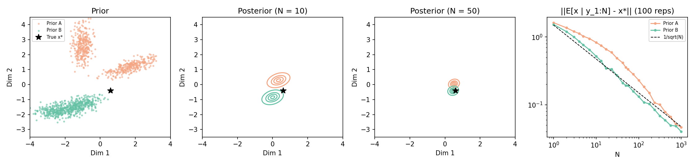

# Weak diffusion priors for inverse problems: a reproduction

Deep Learning course project. We reproduce Jia et al., "Weak Diffusion Priors Can Still Achieve Strong Inverse-Problem Performance" (ICML 2026, [arXiv 2601.22443v2](https://arxiv.org/abs/2601.22443)), from the paper text and its appendix only. The authors' code and project page were never opened.

**The paper's claim.** A weak prior still solves inverse problems almost as well as a matched one. "Weak" means a diffusion model run for only 3 DDIM steps, possibly trained on another domain (for example a bedroom model used for faces). The prior is used by optimising its input noise until the output fits the measurement (INO), with the AdamSphere optimiser and the HoldoutTopK stopping rule.

**Short answer.** Every main-text experiment was run, on 100 test images per setting.
- Reproduced: a mismatched prior costs little; ours ≥ DMPlug in 11 of 12 settings; HoldoutTopK beats variance-based early stopping; the theory checks (Tables 1 and 2, Figure 2).
- Partly reproduced: ours beats DPS on super-resolution and deblurring, but DPS wins random inpainting.
- Not reproduced: the absolute PSNR on faces is 2.5–2.9 dB below the paper. On LSUN bedroom and church it is close.

## Method

- **Weak generator G(z₀):** deterministic 3-step DDIM with timesteps [666, 333, 0], using the public `google/ddpm-{celebahq,bedroom,church}-256` models.
- **INO:** minimise ‖A(G(z₀)) − y‖² over the input noise z₀ for 1000 iterations. A is the forward operator (mask, downsampling or blur); y is the measurement with noise σ = 0.01.
- **AdamSphere:** Adam steps kept on the sphere ‖z₀‖ = r.
- **HoldoutTopK:** 5–20 % of the measured pixels are left out of the loss. The output is the latest iterate among the K = 5 iterates with the lowest loss on those pixels.
- **Baselines:** DPS (1000-step diffusion posterior sampling) and DMPlug (Adam on z₀, stopped by ES-WMV, a variance-based rule).

Implementation choices where the paper is silent: [`repro/README.md`](repro/README.md).

## Experiments

A setting is one method × task × test set × prior, run on the same 100 test images. Every method sees the same images, masks, noise and starting noise z₀. There are 89 settings, about 58 GPU-hours on NAISS Arrhenius (GH200 GPUs). Each setting is one line of [`repro/cluster/cells.txt`](repro/cluster/cells.txt).

| # | experiment | paper | what was run | settings |
|---|---|---|---|---|
| 1 | Identifiability | Table 1 | Mask 70 % of a test image. Is the true image still the closest match among 100 to 15,000 real images? | – |
| 2 | Autocorrelation | Tables 2, 14 | Spatial autocorrelation of 3- and 20-step samples from the 3 models, vs real images | – |
| 3 | Toy posteriors | Fig. 2, Thm 3.2 | Gaussian-mixture priors: do two different priors give the same posterior as observations grow? | – |
| 4 | Main comparison | Tables 3, 6 | Random inpainting (70 % missing), 4× super-resolution, Gaussian deblurring × CelebA-HQ / Bedroom / Church × {DPS, ours with each of the 3 priors} | 36 |
| 5 | Ours vs DMPlug | Tables 4, 7 | The 3 tasks above plus nonlinear (BKSE) deblurring × 3 test sets, matched prior | 15 |
| 6 | Ablation | Table 5 | Adam vs AdamSphere × variance-based stopping vs HoldoutTopK; inpainting and deblurring on Bedroom and Church | 4 |
| 7 | Failure modes | Table 12, Figs. 3, 4, 15 | Box inpainting (box side 0.3–0.6 of the image) and 16× super-resolution on Church: DPS, ours (matched prior), ours (CelebA prior) | 15 |
| 8 | Noise level | Table 16 | CelebA inpainting with σ = 0.05, 0.2, 0.5, 1.0: DPS, ours (matched prior), ours (Church prior) | 12 |
| 9 | Extra: test-set check | – | Experiment 4 on original CelebA faces instead of CelebA-HQ, to explain the face gap | 7 |

Settings in experiment 5 reuse "ours" from experiment 4 for the linear tasks; experiment 6 reuses the AdamSphere settings of experiment 4.

## Results

All numbers: [`results/summary.md`](results/summary.md) (mean ± standard error over 100 images, paper value in brackets). PSNR in dB, ours vs [paper]:

| claim | verdict | evidence |
|---|---|---|
| Table 1: the true image is identifiable | reproduced | gaps CelebA 0.224, Church 0.299, Bedroom 0.260 [0.22, 0.28, 0.27] |
| Table 2: 3-step samples keep the image autocorrelation | reproduced | with "leading" timesteps; Pearson(Bedroom-3, CelebA-20) 0.9946 [0.9987] |
| Fig. 2 / Thm 3.2: posteriors of different priors concentrate on x* | reproduced | 2-D GMM; TV between the two posteriors < 1e-12 for ≥ 32 observed entries |
| Tables 3/6: a mismatched prior costs little | **reproduced** | The loss from an out-of-domain prior matches the paper to ≤ 0.3 dB in 15 of 18 settings and ≤ 0.4 dB in all 18. E.g. CelebA inpainting −0.83 / −0.87 [−1.02 / −1.16]; bedroom SR −0.66 / −0.34 [−0.71 / −0.29]. |
| Tables 3/6: absolute PSNR | LSUN close, CelebA not | Bedroom / church, matched prior: −0.1 to −1.1 dB. CelebA-HQ: −2.7 to −4.6 dB for every prior, and DMPlug shows the same gap. Part of it is the test set: on original CelebA faces the gap is 2.5–2.9 dB. See "CelebA gap" below. |
| Tables 3/6: ours beats DPS | partly | SR and Gaussian deblurring: ours wins 6/6 (+0.4 to +2.6). Random inpainting: DPS wins 3/3 (+0.3 to +0.5). DPS has the better LPIPS in most settings. Our DPS is within ±2.5 dB of the paper's DPS, in both directions. |
| Tables 4/7: ours ≥ DMPlug | reproduced | 11/12 settings [paper: 10/12]. Linear tasks 8/9 (+0.1 to +1.1); the 9th (church SR) is −0.03. Nonlinear deblurring 3/3: paired difference +0.47 / +1.28 / +0.97 for CelebA / Bedroom / Church, ours better on 93–97 % of images [+0.36 / +0.46 / +0.40]. |
| Table 4: nonlinear deblurring, absolute PSNR | higher than the paper | Ours 26.92 / 26.03 / 22.87 [25.21 / 22.67 / 20.88]; DMPlug 26.45 / 24.74 / 21.90 [24.85 / 22.21 / 20.48]. Both methods are 1.4–3.4 above the paper, so our blur is probably milder than the paper's. The paper does not state the kernel-code distribution or clamping; ours: k ~ N(0, 1.2² I) per image, no clamping. |
| Table 5: HoldoutTopK beats variance-based stopping | reproduced | +0.4 to +1.1 [+0.1 to +0.8]. AdamSphere vs Adam: 0.0 to +0.2 [0.0]. |
| Table 12: box masks expose prior mismatch | reproduced, weaker | Ours(Out) is 1.2–1.9 below Ours(In) [1.9–3.1]. DPS is 0.7–1.1 above Ours(In) [about equal]. |
| Table 16: noise | pattern reproduced | Selected iteration falls with σ: 610 → 62 [974 → 119]. INO beats DPS at σ = 0.2 and 0.5 and loses at σ = 1. At σ = 1 our INO is 2.8 dB *better* than the paper's. |

Other numbers:
- HoldoutTopK is insensitive to K: K = 1 to 50 changes PSNR by ≤ 0.17 dB in all 37 INO settings.
- On random masks, SR and deblurring, the oracle (best iterate) is only 0.0–0.3 dB above HoldoutTopK; on box masks it is 0.2–0.8 dB above.
- Nonlinear deblurring: INO is still improving at iteration 1000 (HoldoutTopK picks iteration 997–999). ES-WMV stops at a median of 500–750 iterations. ES-WMV on the same INO trajectories gives 26.43 / 24.75 / 21.89, the same as DMPlug, so the gain over DMPlug comes from the stopping rule, not from the optimizer.
- Compute: about 58 GPU-hours on GH200: 46.4 for the 76 paper settings, 8.6 for the 6 nonlinear-deblurring settings, 2.65 for the CelebA check, plus setup.
- Hardware check: the same 18 images run on a laptop (RTX A1000, one image at a time) and on the GH200 (16 or 25 images at a time) differ by ≤ 0.04 dB (INO) and ≤ 0.33 dB (DPS).

### CelebA gap

The paper does not say where its face images come from.
- It writes "CelebA-HQ (Liu et al., 2015)", and its tables say "CelebA".
- DMPlug, whose setup the paper follows, used "100 images from CelebA [Liu et al.] resized to 256 × 256". The paper's CelebA numbers are close to DMPlug's own CelebA numbers.

Check (experiment 9, `--target celeba178`): 100 original CelebA test faces (178×218), upsampled to 256 with the same crop as LSUN. These faces have 4.7× less high-frequency energy than CelebA-HQ 256.

PSNR, CelebA-HQ → original CelebA [paper]:

| | inpainting | 4× SR | Gaussian deblur |
|---|---|---|---|
| DPS | 29.46 → 31.95 [31.98] | 27.50 → 27.60 [26.82] | 26.91 → 26.92 [27.55] |
| Ours, CelebA prior | 29.18 → 31.23 [33.78] | 28.37 → 28.75 [31.27] | 27.30 → 27.07 [29.98] |
| Ours, Church prior | 28.31 → 31.47 [32.62] | not run | not run |

- DPS inpainting now matches the paper (31.95 vs 31.98). The INO selected iteration moves from 610 to 950 [974]. So the paper's faces are most likely original CelebA, not CelebA-HQ.
- Our INO is still 2.5–2.9 dB below the paper on faces with the CelebA prior. With the church prior the gap is 1.15 dB.
- On original CelebA the INO PSNR is still rising at iteration 1000: +0.46 dB over the last 250 iterations for inpainting. On CelebA-HQ and LSUN it has levelled off (+0.07 to +0.09). So on smooth faces our optimizer gets less far in 1000 iterations than the paper's. One candidate is an unstated detail of AdamSphere or the step size; not tested.
- Ours vs DPS on original CelebA:
  - Inpainting: DPS ahead by 0.7 (CelebA prior) / 0.5 (church prior).
  - SR: ours ahead by 1.15.
  - Deblurring: ours ahead by 0.15.

## Figures

The reconstruction figures show the first two test images of each set; `repro/make_figures.py` rebuilds them.

### Experiment 4: any of the three priors recovers the image



Random inpainting, 70 % of the pixels missing. Columns: measurement; DPS with the matched prior; ours with the CelebA, Bedroom and Church prior; ground truth. With a mismatched prior, ours still recovers faces, bedrooms and churches.


4× super-resolution, same columns.



Gaussian deblurring, same columns.

### Experiment 5: nonlinear deblurring, DMPlug vs ours



Nonlinear (BKSE) motion blur with the matched prior. Columns: measurement, DMPlug, ours, ground truth.

### How the optimisation moves from the prior's domain to the target



Ours at iterations 1, 5, 10, 100 and 1000, then the HoldoutTopK output, ground truth and measurement. With a mismatched prior (rows 2 and 4), the first iterates look like the prior's own domain, a bedroom or a face. By iteration 100–1000 they match the target.

### Experiment 7: where a weak prior fails



Box inpainting and 16× super-resolution on Church. Columns: measurement, DPS, ours with the matched prior (In), ours with the CelebA prior (Out), ground truth. When a large region is unobserved, the 3-step prior fills it with artefacts, worst with the CelebA prior; DPS fills it plausibly.



LPIPS (VGG) of ours minus LPIPS of DPS, against the box size (Figure 4 of the paper). The gap grows with the box and is larger for the mismatched prior, as in the paper. Our in-domain gap is about 0.04–0.05 larger than the paper's, mainly because our DPS has a lower LPIPS than the paper's DPS (0.15–0.26 vs [0.22–0.30]).

### Experiments 2 and 3: theory checks



Spatial autocorrelation of 3- and 20-step samples (lines, ours; circles, paper) and of real test images (grey).



Two different Gaussian-mixture priors (A and B). After N = 10 and N = 50 noisy observations, both posteriors concentrate on the true x* (star). Right: the posterior-mean error falls roughly like 1/√N for both priors.

## Not reproduced

Scope: every main-text experiment has been run. The appendix-only items below were left out by choice.
- Nonlinear deblurring beyond Table 4: the cross-domain and DPS rows of Table 6, and Table 15.
- Latent-diffusion experiments, Table 13.
- Matched-compute comparison, Table 17. Only INO 333 / 1000 iterations vs a single DPS run are covered, in the compute table of `results/summary.md`.
- DAPS / DiffPIR / DRP (Tables 8, 9).
- InverseBench scientific problems (Tables 10, 11).

## Repository

| where | what |
|---|---|
| `repro/` | all code; `repro/README.md` has the implementation choices and how to run |
| `results/summary.md` | all tables: reproduced mean ± s.e. over 100 images, [paper value] |
| `results/figures/`, `results/toy/`, `results/autocorr/` | figures above, plus the raw autocorrelation and toy outputs |
| `results/runs/<setting>/` | per image: metrics (`NNN.json`) and optimisation logs (`NNN_log.npz`); `config.json` |
| `logs/arrhenius/` | the cluster log of every setting |
| `WORKLOG.md` | what was done and checked, in order |
| `synthetic_targets/`, `gen_synthetic_targets.py` | extension: synthetic 1/f^β targets |

## Setup

```bash
conda create -n weakprior python=3.10 -y && conda activate weakprior
pip install -r repro/cluster/requirements.txt pyarrow==25.0.1 lmdb==3.0.0 matplotlib==3.10.9
python -s repro/summarize.py      # rebuilds results/summary.md from results/runs/, no GPU needed
python -s repro/prepare_data.py   # test images -> data/test (not in this repository)
python -s repro/selftest.py       # needs a GPU
```

The pinned torch (2.12 + CUDA 13.0) needs a recent NVIDIA driver; on other machines install a matching torch build. Running experiments: see "How to run" in `repro/README.md`.

## Not in this repository

- `data/` (test images, BKSE code and weights, model caches): rebuild it with the setup above; BKSE is described in `repro/README.md`.
- Per-image reconstruction and measurement PNGs (`results/runs/*/*.png`, 960 MB): `reconstructions_png.zip` on the [Releases page](https://github.com/AnotherFortnight/weak-prior-repro/releases). Unzip it in the repository root; `repro/make_figures.py` needs these files.
- Chest X-ray images (`synthetic_targets/images_medical/`, `synthetic_targets/image_grid.png`): restricted to the research group.
- `synthetic_targets/images*/`: regenerate with `python gen_synthetic_targets.py` (about 15 s).
