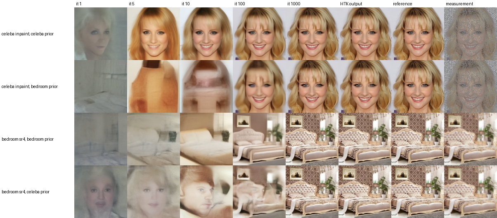
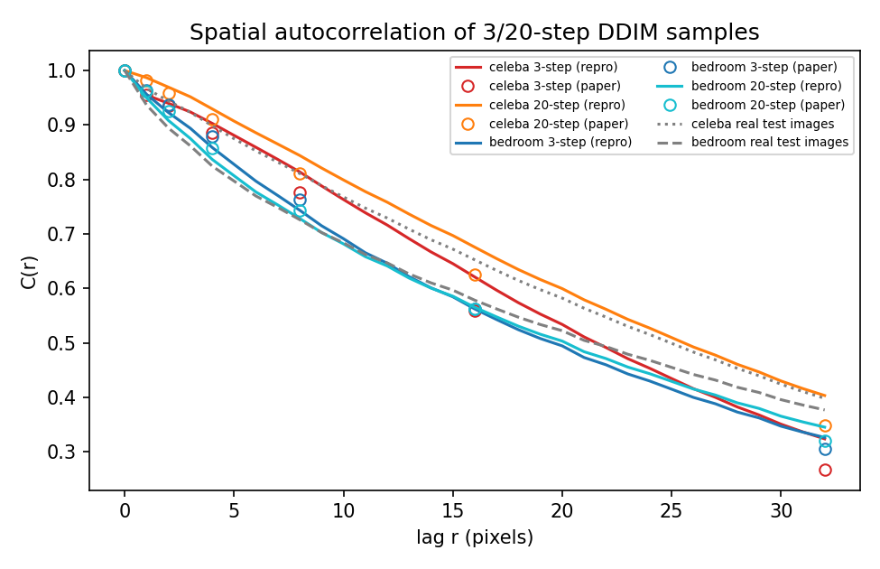
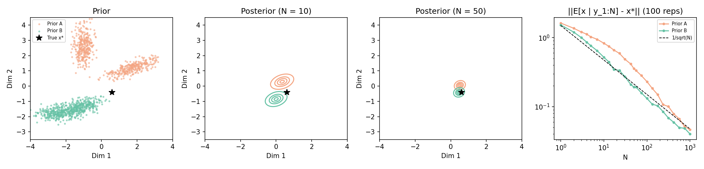
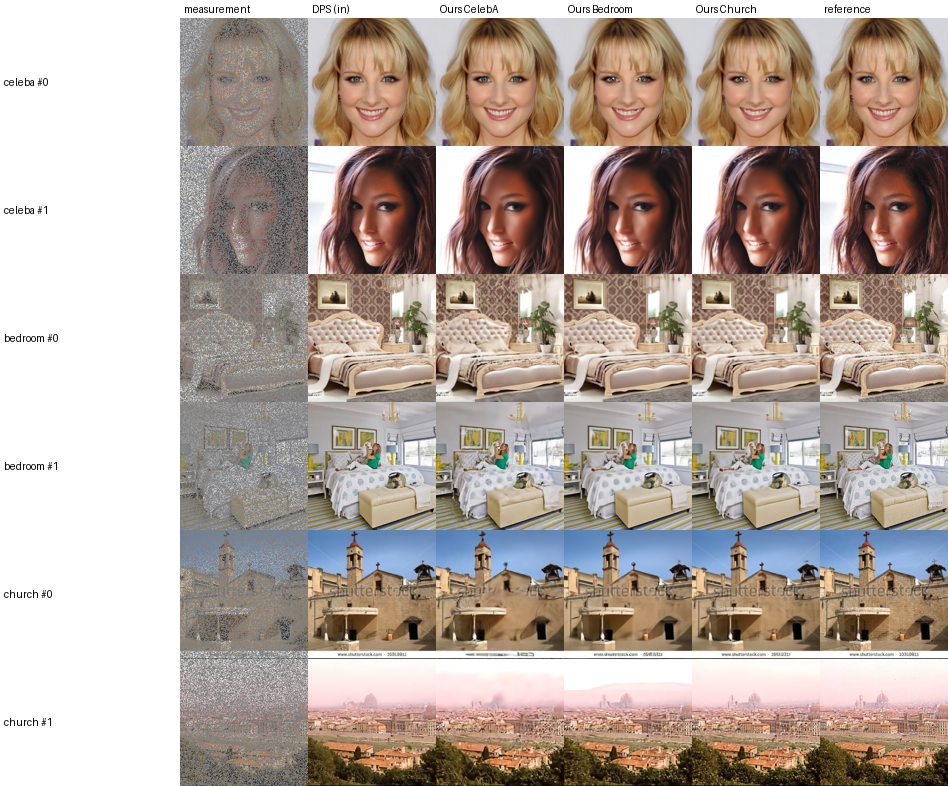
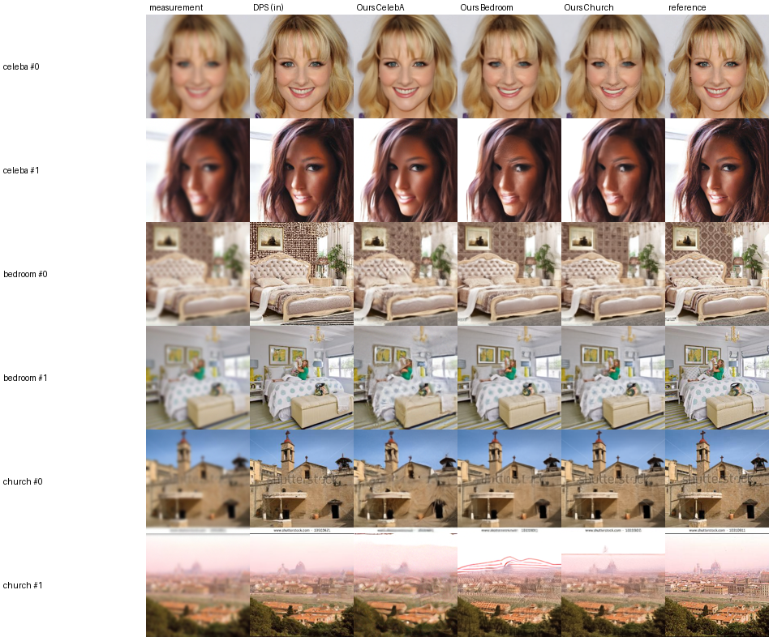
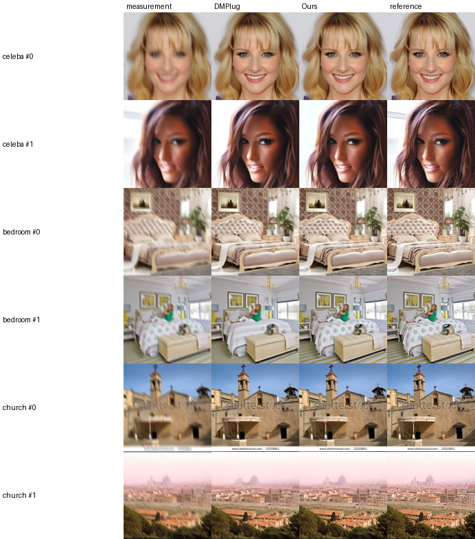
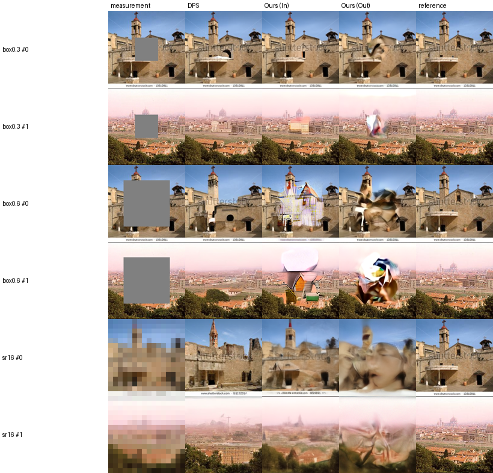
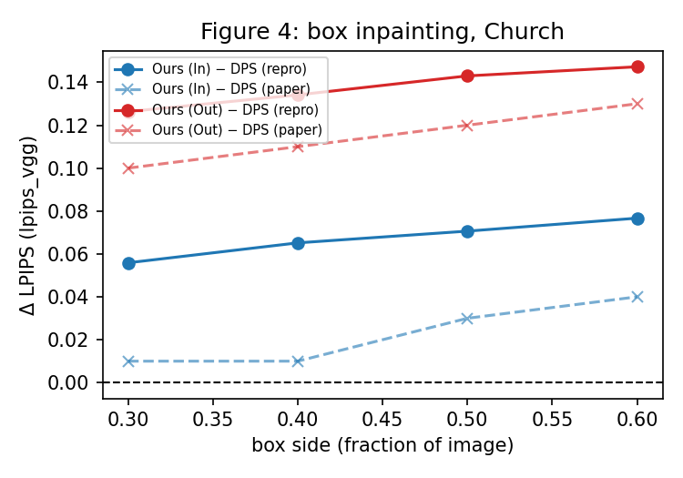
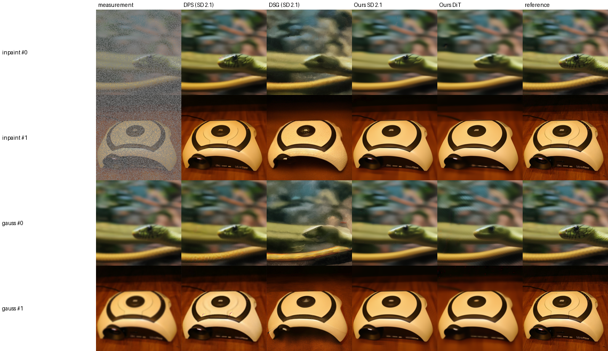

# Weak diffusion priors for inverse problems: a reproduction

Deep Learning course project. We reproduce Jia et al., "Weak Diffusion Priors Can Still Achieve Strong Inverse-Problem Performance" (ICML 2026, [arXiv 2601.22443v2](https://arxiv.org/abs/2601.22443)). We used only the paper text and its appendix; the authors' code and project page were never opened.

**The paper's claim.** A weak prior still solves inverse problems almost as well as a matched one. "Weak" means a diffusion model run for only 3 DDIM steps, possibly trained on another domain (for example a bedroom model used for faces). The prior is used by optimising its input noise until the output fits the measurement (INO), with the AdamSphere optimiser and the HoldoutTopK stopping rule.

**Short answer.** Every main-text experiment was run, on 100 test images per setting.

| experiment | paper | verdict |
|---|---|---|
| E1 identifiability | Table 1 | reproduced |
| E2 autocorrelation of 3-step samples | Tables 2, 14 | reproduced |
| E3 posterior concentration (toy) | Fig. 2, Thm 3.2 | reproduced |
| E4 a mismatched prior costs little | Tables 3, 6 | **reproduced** for all four tasks: within about 0.4 dB of the paper in all 24 cases, with nonlinear deblurring run through the official DPS blur operator (see [Where the gaps come from](#where-the-gaps-come-from)) |
| E4 absolute PSNR | Tables 3, 6 | LSUN close (−0.1 to −1.1 dB); faces 2.3–4.6 dB lower, most likely because the paper used other face images: on original CelebA, ours and DPS are both 2.5 dB below the paper |
| E4 ours beats DPS | Tables 3, 6 | **reproduced with DPS's official default step sizes**: ours wins 9 of 9, and on LSUN the margins are within 0.6 dB of the paper's. With the DPS paper's step size 1 (our main tables), DPS wins random inpainting |
| E5 ours ≥ DMPlug | Tables 4, 7 | reproduced: 11 of 12 [paper: 10 of 12] |
| E6 HoldoutTopK beats variance-based stopping | Table 5 | reproduced |
| E7 weak priors fail on large boxes | Table 12, Figs. 3, 4, 15 | reproduced, smaller effect |
| E8 noise sensitivity | Table 16 | pattern reproduced |
| E10 DPS with a mismatched prior | Table 15 | reproduced (with DPS step size 0.3; the DPS paper's 1.0 diverges here) |
| E11 matched compute | Table 17 | reproduced with DPS's default step size: at 3000 network evaluations ours 29.18 > DPS 28.71 [34.13 > 32.36]; not with step size 1 |
| E12 latent priors (SD 2.1, DiT) on ImageNet | Table 13, Sec. 4.4 | reproduced: about as good as DPS, far above DSG. SD 2.1 matches the paper; our DiT stays 1.9–2.6 dB below it even with a larger learning rate |

Most remaining gaps come from two settings of the DPS code that the paper's baselines most likely used, and from the face test images; see [Where the gaps come from](#where-the-gaps-come-from).

Below, each experiment lists the paper's setting next to ours, the steps, and our numbers next to the paper's. All tables read **ours [paper]**; PSNR is in dB. Full tables with LPIPS, SSIM and standard errors: [`results/summary.md`](results/summary.md). Standard errors of a 100-image mean are about 0.2–0.4 dB.

## Common setup: paper vs ours

| item | paper | ours | |
|---|---|---|---|
| priors | `google/ddpm-{celebahq,bedroom,church}-256` | same checkpoints | same |
| weak generator | 3-step DDIM; the timesteps are not stated | deterministic DDIM (η = 0), timesteps [666, 333, 0]; this spacing matches the paper's Table 2, the other does not (E2) | our choice |
| test images | "randomly select 100 test images" from CelebA-HQ, LSUN Bedroom, LSUN Church | 100 random images (seed 0) from CelebA-HQ-256 val (2,000 images) and the LSUN bedroom / church val sets (300 each) | same size; face source unclear (E9) |
| images for the ablation | 50 | 100 | different |
| measurement noise | Gaussian, σ = 0.01 on [−1, 1] images | same; for inpainting only on the observed pixels | same |
| iterations | 1000 for INO and DMPlug (App. C.12); App. C.11 says "typically 500" | 1000 | same as C.12 |
| learning rate / holdout share (Table 19) | inpainting 0.02 / 10 %, Gaussian deblur 0.02 / 20 %, SR 0.01 / 5 %, nonlinear 0.01 / 10 % | same | same |
| HoldoutTopK K | "K > 1", value not given | K = 5, fixed before any run; K = 1, 3, 10, 20, 50 also recorded | our choice |
| AdamSphere | App. B | project the gradient onto the sphere's tangent space, Adam moments (β = 0.9 / 0.999), step, rescale back to radius ‖z₀‖ | same |
| DPS | 1000 steps, "default config" | DPS Algorithm 1 with step size ζ′ / ‖y − A(x̂₀)‖, ζ′ = 1 (the DPS paper's setting for linear tasks); nonlinear deblurring ζ′ = 0.3 (E10) | our reading |
| DMPlug | "default config"; same 3-step prior and same z₀ as ours | Adam, lr 0.01, fit on all observed pixels, ES-WMV stopping (window 10, patience 100), at most 1000 iterations | DMPlug paper's setting |
| metrics | PSNR, SSIM, LPIPS | PSNR on [0, 1]; SSIM with an 11×11 Gaussian window; LPIPS-VGG in the tables (AlexNet also stored) | details our choice |
| hardware | 8 NVIDIA L40S | NAISS Arrhenius GH200; fp16 UNet with `torch.compile` (gradient cosine to fp32: 0.99998) | different |
| randomness | not stated | each image has its own seed, which fixes the mask, noise, blur kernel and z₀; every method sees the same ones | our choice |

Forward operators (paper Table 18):

| task | paper | ours |
|---|---|---|
| random inpainting | 70 % of pixels removed | exactly 70 % of the pixel positions, same mask for R, G and B |
| Gaussian deblurring | kernel size 61, intensity 3 | 61×61 Gaussian, std 3, reflect padding |
| 4× super-resolution | downsampling ×4 | average over 4×4 blocks (the paper's Sec. 3.2) |
| nonlinear deblurring | BKSE, `GOPRO_wVAE.pth` | BKSE `adaptKernel` on [0, 1] images, full fp32. One kernel code k ~ N(0, 1.2² I) of shape 512×2×2 per image (1.2 from BKSE's own script; the paper gives no value); no clamping |
| box inpainting (E7) | square region, growing | centred square with side 0.3, 0.4, 0.5, 0.6 of the image |
| 16× super-resolution (E7) | factor 16 | average over 16×16 blocks |

Implementation details: [`repro/README.md`](repro/README.md).

## How one run works

One **setting** = method × task × test set × prior. Each setting runs on the same 100 test images; 160 settings in total (one per line of [`repro/cluster/cells.txt`](repro/cluster/cells.txt)), about 95 GPU-hours.

For each test image, ours (INO):
1. Take the test image x* (3×256×256, values in [−1, 1]).
2. Make the measurement y = A(x*) + n with n ~ N(0, σ²). The image's seed fixes the mask, blur kernel and noise.
3. Split the observed pixels at random into a fit set (e.g. 90 %) and a holdout set (e.g. 10 %; Table 19).
4. Draw z₀ ~ N(0, I) with the image's seed; r = ‖z₀‖.
5. Repeat 1000 times: x = G(z) (3 DDIM steps); loss = ‖A(x) − y‖² on the fit pixels; one AdamSphere step on z, which keeps ‖z‖ = r; record the loss on the holdout pixels.
6. Output: among the 5 iterates with the lowest holdout loss, the latest one.
7. Score PSNR, SSIM and LPIPS against x*. The other selection rules are recorded too: last iterate, best iterate ("oracle"), ES-WMV, K = 1 to 50.

The baselines use the same images, measurements and z₀:
- **DPS:** 1000-step reverse diffusion with the in-domain 1000-step model. After every step, a gradient step on ‖y − A(x̂₀)‖, where x̂₀ is the current clean-image estimate.
- **DMPlug:** the same G and z₀ as ours, plain Adam on all observed pixels, stopped by ES-WMV (stop when the variance of the last 10 iterates has not improved for 100 iterations).



Ours at iterations 1, 5, 10, 100 and 1000, then the HoldoutTopK output, the ground truth and the measurement. With a mismatched prior (rows 2 and 4) the first iterates look like the prior's own domain, a bedroom or a face; by iteration 100–1000 they match the target.

## What was run and how long it took

Every setting below ran on all 100 test images (except a few 20-image checks; 15,440 reconstructions in total), on NAISS Arrhenius GH200 GPUs. GPU-hours are the sum of the per-image run times stored in `results/runs/*/NNN.json`.

| experiment | settings | images | GPU-hours |
|---|---|---|---|
| random inpainting (E4, E5): DPS 3, ours 9 (3 priors × 3 test sets), DMPlug 3 | 15 | 1,500 | 10.2 |
| 4× super-resolution (E4, E5): same split | 15 | 1,500 | 11.0 |
| Gaussian deblurring (E4, E5): same split | 15 | 1,500 | 11.8 |
| nonlinear deblurring (E4, E5): same split, DPS with step size 0.3 | 15 | 1,500 | 12.8 |
| ablation with plain Adam (E6) | 4 | 400 | 2.1 |
| box inpainting and 16× SR (E7) | 15 | 1,500 | 5.9 |
| noise levels (E8) | 12 | 1,200 | 4.7 |
| original CelebA faces (E9) | 7 | 700 | 2.6 |
| DPS with a mismatched prior, nonlinear (E10) | 6 | 600 | 1.5 |
| DPS with step size 1 and the step-size check (E10, side columns) | 11 | 940 | 2.4 |
| repeated DPS runs for matched compute (E11) | 5 | 500 | 0.9 |
| latent priors on ImageNet 512 (E12): ours 4 (2 priors × 2 tasks), DPS 2, DSG 2 | 8 | 800 | 12.0 |
| diagnostics for the gaps ([Where the gaps come from](#where-the-gaps-come-from)) | 32 | 2,800 | 16.5 |
| **total** | **160** | **15,440** | **94.5** |

- The cluster accounting also counts start-up and compilation, about 2 % more.
- By method: ours 50.7 GPU-hours (82 settings), DMPlug 26.9 (15), DPS 14.8 (61), DSG 2.1 (2).
- E1–E3 need no reconstructions; each finishes in a few minutes.
- Wall-clock: the settings ran in parallel as Slurm job arrays. The slowest single setting took 2 h 28 min in the main batch and 2 h 48 min in the nonlinear batch, so each batch finished in about 3 hours, not counting queue time. The later batches (E10, E11, the rest of E4) each took under 40 minutes, and E12 about 2 hours.

Time per image:

| method | ours (GH200, fp16) | paper (L40S, Table 17, CelebA inpainting) |
|---|---|---|
| ours / INO, 1000 iterations | 18–21 s (9–25 images per GPU pass) | 171 s |
| DPS, 1000 steps | 6–7 s | 40 s |
| DMPlug, up to 1000 iterations | 61–82 s (one image at a time) | not reported |
| ours, latent priors at 512 px (E12), 500 iterations | 67–74 s (4 images per GPU pass) | about 7 min (SD 2.1, App. C.12) |
| DPS / DSG, latent, 500 steps (E12) | 37–39 s (5 images per GPU pass) | not reported |

## E1. Identifiability (Table 1)

**Paper.** For each of 100 target images: remove 70 % of the pixels and add noise. Apply the same mask to every image "in the dataset" and compute the MSE on the observed pixels. Gap = second-smallest MSE − smallest MSE. The pool size is not stated.

**Ours.** Same procedure. Because the pool size is not stated, we use pools from 100 images (the test images) up to the whole available split.

| dataset | paper: mean (std), min | ours, pool = the 100 test images | ours, largest pool | true image has the smallest MSE |
|---|---|---|---|---|
| CelebA | 0.22 (0.06), 0.11 | 0.224 (0.062), 0.088 | 0.157 (0.047), 0.044 — 6,667 images | 100 % for every pool |
| Church | 0.28 (0.06), 0.15 | 0.299 (0.064), 0.182 | 0.222 (0.055), 0.102 — 6,612 images | 100 % |
| Bedroom | 0.27 (0.07), 0.09 | 0.260 (0.074), 0.137 | 0.189 (0.057), 0.066 — 15,457 images | 100 % |

The paper's numbers are closest to a pool of just the 100 test images. Larger pools shrink the gap, but it stays above zero and the true image is always the closest.

## E2. Autocorrelation of 3-step samples (Tables 2, 14)

**Paper.** CelebA-HQ and LSUN Bedroom models, 3 and 20 DDIM steps, 100 unconditional samples each. Normalised spatial autocorrelation C(r) (App. C.8), averaged over samples, colour channels and all directions at each rounded distance r.

**Ours.** Same definition and 100 samples per setting. Because the paper does not state the DDIM timesteps, both common spacings were run: "leading" [666, 333, 0] and "trailing" [999, 666, 333].

C(r), leading spacing:

| lag r | CelebA 3-step | CelebA 20-step | Bedroom 3-step | Bedroom 20-step |
|---|---|---|---|---|
| 1 | 0.955 [0.956] | 0.987 [0.981] | 0.956 [0.965] | 0.950 [0.962] |
| 2 | 0.940 [0.936] | 0.970 [0.959] | 0.923 [0.937] | 0.908 [0.926] |
| 4 | 0.903 [0.887] | 0.930 [0.910] | 0.859 [0.879] | 0.837 [0.857] |
| 8 | 0.814 [0.777] | 0.844 [0.811] | 0.744 [0.764] | 0.729 [0.744] |
| 16 | 0.621 [0.560] | 0.676 [0.626] | 0.562 [0.563] | 0.566 [0.562] |
| 32 | 0.324 [0.267] | 0.404 [0.348] | 0.326 [0.305] | 0.345 [0.321] |

- RMSE to the paper's profile: 3-step CelebA 0.035 (leading) vs 0.099 (trailing); 3-step Bedroom 0.015 vs 0.084. So the paper used the leading spacing, and we use it everywhere.
- Pearson correlation of the Bedroom 3-step and CelebA 20-step profiles over lags 1–32: 0.9946 [0.9987]. Over the representative lags (Table 14), all pairs are 0.988–0.9998 [0.9965–0.9998].



Lines: ours. Circles: the paper's Table 2. Grey: real test images.

## E3. Posterior concentration, toy model (Fig. 2, Theorem 3.2)

**Paper.** Figure 2 shows two different 2-D Gaussian-mixture priors whose posteriors both concentrate around the true x* as the number of observations N grows. Theorem 3.2 is proved but not tested numerically.

**Ours.**
- Part 1 (Figure 2): two well-separated 2-D mixtures, observations y_i = A x* + ε_i, exact mixture posterior, N = 1 to 1000, 100 repetitions.
- Part 2 (our own check of Theorem 3.2): a mixture prior whose 2,000 means are real CelebA-HQ images (32×32 RGB). Random inpainting with m observed entries. Two priors with different component weights (ratio 10).

| observed entries m | P(wrong component), prior A / B | total-variation distance between the two posteriors | both posteriors pick the true component |
|---|---|---|---|
| 4 | 0.81 / 0.82 | 0.23 | 20 % |
| 8 | 0.17 / 0.19 | 0.059 | 84 % |
| 16 | 0.006 / 0.006 | 0.0018 | 99.7 % |
| 32 | 2e-12 / 7e-13 | 1e-12 | 100 % |



After N = 10 and N = 50 observations, both posteriors sit on x* (star); the error of the posterior mean falls roughly like 1/√N for both priors (right).

## E4. Main comparison: does a mismatched prior hurt? (Tables 3, 6)

**Paper.** Four tasks on three test sets: random inpainting and 4× SR (Table 3), Gaussian and nonlinear deblurring (Table 6). DPS with the matched 1000-step model, against ours with each of the three 3-step priors. 100 images per setting.

**Ours.** The same 48 settings (4 tasks × 3 test sets × 4 methods), with the common setup above. DPS on nonlinear deblurring uses step size ζ′ = 0.3 (E10).

PSNR, ours [paper]:

| task | method | CelebA | Bedroom | Church |
|---|---|---|---|---|
| inpainting | DPS (matched) | 29.46 [31.98] | 29.13 [27.97] | 24.16 [24.15] |
| | ours, CelebA prior | 29.18 [33.78] | 27.54 [27.78] | 22.92 [23.56] |
| | ours, Bedroom prior | 28.35 [32.76] | 28.65 [28.88] | 23.44 [24.22] |
| | ours, Church prior | 28.31 [32.62] | 28.33 [28.66] | 23.90 [24.93] |
| 4× SR | DPS (matched) | 27.50 [26.82] | 25.26 [22.95] | 21.22 [20.28] |
| | ours, CelebA prior | 28.37 [31.27] | 25.08 [25.88] | 21.59 [22.68] |
| | ours, Bedroom prior | 27.36 [30.34] | 25.75 [26.59] | 21.83 [22.86] |
| | ours, Church prior | 27.24 [30.10] | 25.40 [26.30] | 22.03 [23.09] |
| Gaussian deblur | DPS (matched) | 26.91 [27.55] | 22.61 [23.94] | 19.72 [20.66] |
| | ours, CelebA prior | 27.30 [29.98] | 24.77 [25.02] | 21.64 [22.21] |
| | ours, Bedroom prior | 25.35 [27.97] | 25.16 [25.28] | 21.40 [22.09] |
| | ours, Church prior | 25.34 [27.66] | 24.86 [24.76] | 21.48 [22.43] |
| nonlinear deblur | DPS (matched) | 25.27 [24.88] | 23.47 [22.51] | 20.19 [20.31] |
| | ours, CelebA prior | 26.92 [25.21] | 23.96 [22.34] | 21.46 [20.52] |
| | ours, Bedroom prior | 25.25 [24.59] | 26.03 [22.67] | 22.31 [20.79] |
| | ours, Church prior | 25.43 [24.73] | 25.47 [22.59] | 22.87 [20.88] |

The paper's main claim is the **cost of a mismatched prior**: PSNR with the other prior minus PSNR with the matched prior. For the three linear tasks we reproduce it closely:

| task | test set | other prior 1 | other prior 2 | ours − DPS |
|---|---|---|---|---|
| inpainting | CelebA | Bedroom −0.83 [−1.02] | Church −0.87 [−1.16] | −0.28 [+1.80] |
| | Bedroom | CelebA −1.11 [−1.10] | Church −0.32 [−0.22] | −0.48 [+0.91] |
| | Church | CelebA −0.98 [−1.37] | Bedroom −0.46 [−0.71] | −0.26 [+0.78] |
| 4× SR | CelebA | Bedroom −1.01 [−0.93] | Church −1.13 [−1.17] | +0.87 [+4.45] |
| | Bedroom | CelebA −0.67 [−0.71] | Church −0.35 [−0.29] | +0.49 [+3.64] |
| | Church | CelebA −0.44 [−0.41] | Bedroom −0.20 [−0.23] | +0.81 [+2.81] |
| Gaussian deblur | CelebA | Bedroom −1.95 [−2.01] | Church −1.96 [−2.32] | +0.39 [+2.43] |
| | Bedroom | CelebA −0.39 [−0.26] | Church −0.30 [−0.52] | +2.55 [+1.34] |
| | Church | CelebA +0.16 [−0.22] | Bedroom −0.08 [−0.34] | +1.76 [+1.77] |
| nonlinear deblur | CelebA | Bedroom −1.67 [−0.62] | Church −1.49 [−0.48] | +1.65 [+0.33] |
| | Bedroom | CelebA −2.07 [−0.33] | Church −0.56 [−0.08] | +2.56 [+0.16] |
| | Church | CelebA −1.41 [−0.36] | Bedroom −0.56 [−0.09] | +2.68 [+0.57] |

- **Mismatch cost:** for the three linear tasks, within 0.3 dB of the paper in 15 of 18 cases and within 0.4 dB in all 18. For nonlinear deblurring it is 0.6–2.1 dB, 3–7 times the paper's 0.1–0.6 dB; even so, ours with a mismatched prior scores above the paper's numbers.
- **Absolute PSNR:** on Bedroom and Church our matched-prior PSNR is 0.1–1.1 dB below the paper. On faces it is 2.3–4.6 dB below, for every prior, and DMPlug shows a similar gap (E5). Part of this is the test set (E9). On nonlinear deblurring ours is 0.7–3.4 dB *above* the paper, while DPS on the same measurements matches the paper within 1 dB.
- **Ours vs DPS:** ours wins SR and both deblurring tasks (9 of 9; nonlinear by 1.7–2.7 dB [0.2–0.6]) but loses random inpainting by 0.3–0.5 dB, where the paper wins by 0.8–1.8 dB. DPS has the better LPIPS in most settings.



Random inpainting (70 % missing). Columns: measurement; DPS with the matched prior; ours with the CelebA, Bedroom and Church prior; ground truth. With any of the three priors, ours recovers faces, bedrooms and churches.


4× super-resolution, same columns.



Gaussian deblurring, same columns.

## E5. Ours vs DMPlug (Tables 4, 7)

**Paper.** Both methods optimise the input noise of the same matched 3-step prior, from the same z₀, for the same number of iterations. They differ in optimiser (AdamSphere vs Adam) and stopping rule (HoldoutTopK vs ES-WMV). Table 4: random inpainting and nonlinear deblurring; Table 7: Gaussian deblurring and 4× SR.

**Ours.** The same 12 settings. DMPlug as described in the common setup; nonlinear deblurring with BKSE as in the operator table.

| task | test set | ours | DMPlug | ours − DMPlug | LPIPS ours / DMPlug |
|---|---|---|---|---|---|
| inpainting | CelebA | 29.18 [33.78] | 28.90 [32.78] | +0.28 [+1.00] | 0.24 / 0.27 [0.15 / 0.19] |
| | Bedroom | 28.65 [28.88] | 27.51 [28.27] | +1.14 [+0.61] | 0.22 / 0.28 [0.20 / 0.26] |
| | Church | 23.90 [24.93] | 23.78 [24.96] | +0.12 [−0.03] | 0.27 / 0.28 [0.23 / 0.25] |
| 4× SR | CelebA | 28.37 [31.27] | 28.11 [31.12] | +0.26 [+0.15] | 0.25 / 0.27 [0.18 / 0.20] |
| | Bedroom | 25.75 [26.59] | 25.64 [26.31] | +0.11 [+0.28] | 0.27 / 0.30 [0.25 / 0.28] |
| | Church | 22.03 [23.09] | 22.06 [23.18] | −0.03 [−0.09] | 0.31 / 0.31 [0.27 / 0.28] |
| Gaussian deblur | CelebA | 27.30 [29.98] | 27.05 [29.52] | +0.25 [+0.46] | 0.27 / 0.29 [0.21 / 0.23] |
| | Bedroom | 25.16 [25.28] | 24.65 [25.08] | +0.51 [+0.20] | 0.29 / 0.33 [0.30 / 0.33] |
| | Church | 21.48 [22.43] | 21.36 [22.24] | +0.12 [+0.19] | 0.34 / 0.37 [0.30 / 0.32] |
| nonlinear deblur | CelebA | 26.92 [25.21] | 26.45 [24.85] | +0.47 [+0.36] | 0.28 / 0.29 [0.27 / 0.28] |
| | Bedroom | 26.03 [22.67] | 24.74 [22.21] | +1.29 [+0.46] | 0.28 / 0.33 [0.39 / 0.41] |
| | Church | 22.87 [20.88] | 21.90 [20.48] | +0.97 [+0.40] | 0.29 / 0.35 [0.39 / 0.42] |

- Ours ≥ DMPlug in PSNR in 11 of 12 settings [paper: 10 of 12]; the exception differs by only 0.03 dB. Ours has the lower or equal LPIPS in all 12, as in the paper.
- On nonlinear deblurring, ours is better on 93–97 % of the single images. Both methods score 1.4–3.4 dB *above* the paper. DPS on the same measurements matches the paper (E4), so a milder blur alone does not explain this; the cause is open. The paper gives no kernel distribution or clamping.
- Where the gain comes from (nonlinear deblurring): our PSNR is still rising at iteration 1000, and HoldoutTopK picks iteration 997–999. ES-WMV stops at a median of 500–750 iterations. Applied to our own trajectories, ES-WMV gives the same PSNR as DMPlug (within 0.02 dB). So the gain comes from the stopping rule, not from the optimiser.



Nonlinear (BKSE) motion blur with the matched prior. Columns: measurement, DMPlug, ours, ground truth.

## E6. Ablation: optimiser and stopping rule (Table 5)

**Paper.** Four variants: (A) Adam + variance-based stopping, (B) Adam + HoldoutTopK, (C) AdamSphere + variance, (D) AdamSphere + HoldoutTopK. Gaussian deblurring and inpainting on Church and Bedroom, 50 images.

**Ours.** The same four variants on 100 images. "Variance" is ES-WMV (window 10, patience 100), evaluated on the same trajectory as HoldoutTopK, so (A)/(B) and (C)/(D) differ only in the stopping rule.

| task | test set | (A) | (B) | (C) | (D) | HoldoutTopK gain (D − C) | AdamSphere gain (D − B) |
|---|---|---|---|---|---|---|---|
| Gaussian deblur | Church | 20.95 [22.03] | 21.32 [22.39] | 21.09 [22.05] | 21.48 [22.40] | +0.39 [+0.36] | +0.16 [+0.01] |
| | Bedroom | 24.30 [24.83] | 24.93 [25.60] | 24.45 [24.85] | 25.16 [25.60] | +0.71 [+0.74] | +0.23 [+0.00] |
| inpainting | Church | 23.42 [24.72] | 23.89 [24.84] | 23.47 [24.74] | 23.90 [24.84] | +0.42 [+0.10] | +0.01 [+0.00] |
| | Bedroom | 27.55 [28.67] | 28.65 [29.16] | 27.63 [28.56] | 28.65 [29.16] | +1.02 [+0.60] | −0.00 [+0.01] |

HoldoutTopK beats variance-based stopping in every case (+0.4 to +1.0 dB, paper +0.1 to +0.7). AdamSphere matches Adam (0.0 to +0.2 dB), as in the paper.

## E7. Failure modes: large boxes and 16× SR (Table 12, Figures 3, 4, 15)

**Paper.** Church test images. DPS (matched 1000-step model), ours with the Church prior ("In") and with the CelebA prior ("Out"). Box inpainting with square boxes of growing size (Table 12: 0.3 to 0.6 of the side); 16× SR shown only qualitatively.

**Ours.** The same methods; a centred square box of side 0.3–0.6; inpainting learning rate and holdout share. 16× SR with the SR setting.

| box side | DPS | ours (In) | ours (Out) | LPIPS: DPS / In / Out |
|---|---|---|---|---|
| 0.3 | 23.81 [25.00] | 22.73 [25.28] | 20.85 [22.42] | 0.15 / 0.21 / 0.28 [0.22 / 0.23 / 0.32] |
| 0.4 | 20.65 [22.28] | 19.94 [22.31] | 18.21 [19.20] | 0.18 / 0.24 / 0.31 [0.24 / 0.25 / 0.35] |
| 0.5 | 18.47 [19.38] | 17.67 [19.09] | 16.20 [16.81] | 0.22 / 0.29 / 0.36 [0.27 / 0.30 / 0.39] |
| 0.6 | 16.35 [17.72] | 15.62 [17.27] | 14.42 [15.35] | 0.26 / 0.34 / 0.41 [0.30 / 0.34 / 0.43] |

16× SR on Church (no paper numbers): DPS 16.29, ours (In) 17.53, ours (Out) 17.57 dB; LPIPS 0.46 / 0.50 / 0.62.

- As in the paper, the mismatched prior fails on large boxes: ours (Out) is 1.2–1.9 dB below ours (In) [1.9–3.1].
- Unlike the paper, DPS beats ours (In) already at the smallest box (+0.7 to +1.1 dB) [about equal at 0.3–0.4].



Columns: measurement, DPS, ours (In), ours (Out), ground truth. The 3-step prior fills large holes with artefacts, worst with the CelebA prior; DPS fills them plausibly.



LPIPS of ours minus LPIPS of DPS against box size (the paper's Figure 4). The gap grows with the box and is larger for the mismatched prior, as in the paper. Our gap for ours (In) is about 0.04–0.05 larger, mainly because our DPS has a lower LPIPS than the paper's.

## E8. Noise level (Table 16)

**Paper.** CelebA inpainting with σ ∈ {0.01, 0.05, 0.2, 0.5, 1.0}. DPS (matched), ours with the CelebA prior (in) and with the Church prior (out). Also reports the iteration HoldoutTopK selects.

**Ours.** The same 15 settings.

| σ | DPS | ours (in) | ours (out) | selected iteration, in / out |
|---|---|---|---|---|
| 0.01 | 29.46 [31.98] | 29.18 [33.78] | 28.31 [32.62] | 610 / 607 [974 / 973] |
| 0.05 | 29.10 [30.12] | 29.02 [33.39] | 27.99 [32.08] | 554 / 527 [941 / 921] |
| 0.2 | 27.48 [26.93] | 27.74 [30.41] | 26.38 [28.38] | 261 / 250 [359 / 351] |
| 0.5 | 25.54 [24.45] | 25.72 [26.30] | 23.82 [23.86] | 116 / 102 [169 / 156] |
| 1.0 | 23.69 [22.42] | 23.31 [20.52] | 21.24 [16.88] | 62 / 49 [119 / 108] |

- As in the paper, the selected iteration falls as noise grows (stronger early stopping), and the gap between the in- and out-of-domain prior widens.
- Ours (in) beats DPS at σ = 0.2 and 0.5 and loses at σ = 1.0, as in the paper. At σ ≤ 0.05 the face gap of E4 makes DPS win.
- At σ = 1.0 our INO is 2.8 dB *better* than the paper's.

## E9. Extra: which face images did the paper use?

The paper writes "CelebA-HQ" but its tables say "CelebA", and the DMPlug paper, whose setup it follows, used original CelebA images. We reran experiment E4 on 100 original CelebA test faces (178×218, upsampled to 256).

| method | inpainting | 4× SR | Gaussian deblur |
|---|---|---|---|
| DPS | 29.46 → 31.95 [31.98] | 27.50 → 27.60 [26.82] | 26.91 → 26.92 [27.55] |
| ours, CelebA prior | 29.18 → 31.23 [33.78] | 28.37 → 28.75 [31.27] | 27.30 → 27.07 [29.98] |
| ours, Church prior | 28.31 → 31.47 [32.62] | not run | not run |

(CelebA-HQ → original CelebA [paper].)

- DPS inpainting now matches the paper (31.95 vs 31.98), and the selected INO iteration moves from 610 to 950 [974]. So the paper's faces are most likely original CelebA.
- Our INO is still 2.5–2.9 dB below the paper on faces; on original CelebA its PSNR is still rising at iteration 1000 (+0.46 dB over the last 250 iterations). An unstated detail of AdamSphere or the step size could explain this; not tested.

## E10. DPS with a mismatched prior, nonlinear deblurring (Table 15)

**Paper.** DPS with the matched and the two mismatched 1000-step models on nonlinear deblurring. Sec. 2 cites it to separate the effect of the prior's domain from the effect of the solver (App. C.9).

**Ours.** The same 9 settings.
- With the DPS paper's step size for this task (ζ′ = 1), 0–29 % of the images per setting diverge into stripe patterns, which the BKSE blur network still maps close to y. A few give NaN.
- So we chose ζ′ from {1, 0.3, 0.1} on the first 20 Church and Bedroom test images, a choice that can only help DPS. Mean PSNR: Church 17.94 / 20.03 / 18.64; Bedroom 21.71 / 22.39 / 20.66. We use ζ′ = 0.3.
- With ζ′ = 0.3, one image (Church, CelebA prior) still gives NaN and is left out of that mean.

| test set | DPS prior | PSNR, ζ′ = 0.3 | LPIPS | PSNR, ζ′ = 1 | failed images, ζ′ = 1 |
|---|---|---|---|---|---|
| CelebA | CelebA | 25.27 [24.88] | 0.26 [0.26] | 23.24 | 0 |
| | Bedroom | 23.52 [23.57] | 0.40 [0.41] | 20.06 | 0 |
| | Church | 23.06 [22.38] | 0.42 [0.43] | 19.11 | 3 |
| Bedroom | Bedroom | 23.47 [22.51] | 0.32 [0.38] | 21.79 | 4 |
| | CelebA | 21.91 [21.98] | 0.47 [0.48] | 17.76 | 9 |
| | Church | 22.63 [22.04] | 0.38 [0.42] | 18.00 | 15 |
| Church | Church | 20.19 [20.31] | 0.35 [0.39] | 17.86 | 18 |
| | CelebA | 19.40 [20.06] | 0.51 [0.51] | 15.19 | 20 |
| | Bedroom | 20.04 [19.84] | 0.43 [0.47] | 16.35 | 29 |

("Failed" = PSNR below 12 dB or NaN.)

- With ζ′ = 0.3 every DPS number is within 1 dB of the paper.
- As in the paper, a mismatched prior also costs DPS something, 0.2–2.2 dB [0.3–2.5], but DPS does not collapse.

## E11. Matched compute (Table 17)

**Paper.** CelebA-HQ inpainting. Ours at 333 and 1000 iterations (about 1000 and 3000 network evaluations) against DPS run once, or 3 or 5 times keeping the best run.

**Ours.** The same, on our 100 CelebA-HQ test images. The extra DPS runs use new sampling seeds on the same measurements. The paper does not say how the best run is picked. We pick the run with the smallest residual ‖A(x) − y‖, which needs no ground truth, and also report the pick with the highest PSNR.

| method | network evaluations | seconds / image | PSNR | PSNR, best-PSNR pick |
|---|---|---|---|---|
| ours, 333 iterations | 999 | 6 [56] | 28.43 [31.86] | |
| DPS, 1 run | 1000 | 6 [40] | 29.46 [32.27] | |
| ours, 1000 iterations | 3000 | 19 [171] | 29.18 [34.13] | |
| DPS, best of 3 | 3000 | 19 [120] | 29.45 [32.36] | 29.53 |
| DPS, best of 5 | 5000 | 32 [200] | 29.44 [32.40] | 29.55 |

(Seconds: ours on GH200 with batching, [paper on L40S].)

- As in the paper, extra DPS runs hardly help: +0.0 dB here, +0.1 dB in the paper.
- Unlike the paper, ours does not overtake DPS at equal cost. At 3000 evaluations ours is 0.3 dB below DPS [1.8 dB above]. This is the face gap of E4 again.

## E12. Latent diffusion priors on ImageNet (Table 13, Sec. 4.4)

**Paper.** Stable Diffusion 2.1 and DiT as few-step priors on ImageNet, for inpainting and Gaussian deblurring.
- Ours: 500 iterations, learning rate 0.2 (SD 2.1) / 0.1 (DiT), null prompt / null class.
- Baselines: DPS and DSG with SD 2.1, 500 steps. They come from a third-party implementation (github.com/tongdaxu/diffusers-Diffusion-Posterior-Sampling).

**Ours** (`repro/latent.py`).
- **Test images:** 100 random ImageNet validation images from the first of 14 validation shards, cropped to 512 px. Same operators as before (70 % random inpainting; 61×61 Gaussian blur, std 3) and σ = 0.01.
- **Ours:** 3 DDIM steps in latent space, then the VAE decoder (the paper does not give the step count). AdamSphere, 500 iterations, learning rate 0.2 / 0.1, HoldoutTopK with K = 5 and a 10 % / 20 % holdout.
- **DPS and DSG:** as in the third-party implementation: SD 2.1, 500 Euler-ancestral steps, no classifier-free guidance. DPS scale 4.8 and DSG guidance rate 0.02, both from its README.
- **Images published:** only the two examples below, as in the paper's Figures 11 and 12. The per-image outputs are not published: ImageNet's terms allow sharing only with people who have agreed to them.

| task | method | prior | PSNR | LPIPS | SSIM |
|---|---|---|---|---|---|
| inpainting | ours | DiT | 25.27 [28.44] | 0.47 [0.39] | 0.67 [0.73] |
| | ours | SD 2.1 | 26.74 [26.82] | 0.40 [0.37] | 0.72 [0.74] |
| | DPS | SD 2.1 | 25.93 [28.21] | 0.33 [0.29] | 0.74 [0.80] |
| | DSG | SD 2.1 | 21.81 [23.33] | 0.54 [0.50] | 0.53 [0.60] |
| Gaussian deblur | ours | DiT | 23.66 [26.48] | 0.52 [0.46] | 0.60 [0.68] |
| | ours | SD 2.1 | 24.58 [25.40] | 0.48 [0.44] | 0.63 [0.69] |
| | DPS | SD 2.1 | 23.39 [25.49] | 0.44 [0.39] | 0.65 [0.73] |
| | DSG | SD 2.1 | 21.07 [22.09] | 0.54 [0.51] | 0.47 [0.54] |

- **The paper's claim holds.** Few-step latent priors reconstruct about as well as DPS: ours with SD 2.1 is 0.8 / 1.2 dB above DPS, with DiT −0.7 / +0.3. They are far above DSG: +2.6 to +4.9 dB [+3.3 to +5.1]. As in the paper, DPS has the best LPIPS.
- **The two priors swap order.** In the paper DiT is better than SD 2.1 (by 1.6 / 1.1 dB); here SD 2.1 is better (by 1.5 / 0.9 dB). Our SD 2.1 numbers are within 0.8 dB of the paper, our DiT numbers 2.8–3.2 dB below.
- **Ours is still improving at iteration 500.** HoldoutTopK picks the last iteration, and the best iterate is at most 0.03 dB higher. More iterations or another learning rate might lift DiT; not tested.
- **The baselines are lower too.** DPS and DSG are 1.0–2.3 dB below the paper. The paper gives no step sizes for them, and the README values we use were given for other tasks.



The first two test images. Columns: measurement, DPS, DSG, ours with SD 2.1, ours with DiT, ground truth. DSG leaves visible artefacts (rows 1 and 3).

## Where the gaps come from

We tested one hypothesis per gap on the first 20 images of each setting, and then confirmed it on all 100. The numbers below are 100-image means. Two facts from the official DPS code (github.com/DPS2022/diffusion-posterior-sampling; third-party, not the paper's authors) turned out to matter:
- **Step size.** Its default configs use ζ′ = 0.5 for inpainting and 0.3 for the other tasks. The DPS paper's appendix, which our main tables follow, says ζ′ = 1.
- **Nonlinear blur.** Its nonlinear blur operator draws a **new random kernel on every call**, and clamps its output. So the measurement and every reconstruction step see different blurs.

The paper says DPS and DMPlug were run "under their default configs", which points to this code.

**1. Ours vs DPS (E4) and matched compute (E11): explained by the DPS step size.**

With DPS's default step sizes, ours beats DPS in all 9 settings, as in the paper. On LSUN the margins are within 0.6 dB of the paper's.

| task | ours − DPS, CelebA | Bedroom | Church |
|---|---|---|---|
| inpainting | +0.47 [+1.80] | +1.08 [+0.91] | +0.73 [+0.78] |
| 4× SR | +2.90 [+4.45] | +3.07 [+3.64] | +2.58 [+2.81] |
| Gaussian deblur | +1.13 [+2.43] | +1.59 [+1.34] | +1.72 [+1.77] |

- DPS itself is then also closer to the paper on LSUN: inpainting 27.57 / 23.17 [27.97 / 24.15], SR 22.67 / 19.46 [22.95 / 20.28], deblurring 23.57 / 19.75 [23.94 / 20.66].
- With ζ′ = 1 (the main tables), DPS is up to 2.6 dB stronger and wins random inpainting.
- Matched compute (Table 17): at 3000 network evaluations ours reaches 29.18 and DPS 28.71, so ours overtakes DPS as in the paper [34.13 vs 32.36]. At about 1000 evaluations, DPS is still ahead: 28.71 vs 28.43 [32.27 vs 31.86].

**2. Nonlinear deblurring (E4, E5): explained by the DPS blur operator.**

With the official DPS operator, the cost of a mismatched prior matches the paper within about 0.4 dB in all 6 cases. With our fixed kernel it was 3–7 times larger.

| test set | ours, matched prior | cost of other prior 1 | cost of other prior 2 | ours − DPS | ours − DMPlug |
|---|---|---|---|---|---|
| CelebA | 23.90 [25.21] | Bedroom −0.21 [−0.62] | Church −0.48 [−0.48] | +0.03 [+0.33] | +0.44 [+0.36] |
| Bedroom | 22.84 [22.67] | CelebA −0.44 [−0.33] | Church −0.06 [−0.08] | +0.28 [+0.16] | +0.80 [+0.46] |
| Church | 20.76 [20.88] | CelebA −0.52 [−0.36] | Bedroom −0.16 [−0.09] | +0.75 [+0.57] | +1.05 [+0.40] |

- On Bedroom and Church the absolute numbers now match the paper within 0.2 dB, for ours and DPS (22.56 / 20.01 [22.51 / 20.31]). DMPlug is within 0.8 dB.
- On faces all three methods are about 1 dB below the paper (see point 3).
- The paper most likely used this operator. Our fixed-kernel operator is the correct forward model and gives higher scores; our main tables keep it.

**3. Faces (E4, E9): not our optimiser; most likely different test images.**

- **The optimiser is not the cause.** On original CelebA inpainting (ours 31.21 on 20 images) we tried:
  - no x̂₀ clipping: +0.17 dB
  - learning rate 0.05: −0.67 dB
  - 2000 iterations: +0.41 dB
  - trailing timesteps: −6.4 dB, which also confirms our leading choice
- **Both methods are low by the same amount.** With DPS's default step size, DPS on the same 100 faces gives 29.48 [31.98] and ours 31.23 [33.78]: both are 2.5 dB below the paper, and ours leads DPS by 1.75 [1.80].
- **So the paper's face images are probably easier than ours.** We cannot check this: the paper does not list its images.

**4. DiT latent prior (E12): only partly explained.**

With learning rate 0.2 instead of 0.1, DiT gains 1.3 dB on inpainting (26.54 [28.44]) but only 0.2 dB on deblurring (23.84 [26.48]). It is still improving at the last iteration. It stays 1.9–2.6 dB below the paper and below our SD 2.1 run. The paper does not give DiT's number of sampling steps or other settings, so the cause is open.

**Where to find these runs:** the diagnostic settings are cells 131–162 of `repro/cluster/cells.txt` (`run.py --zeta`, the task `nonlinear_dps`, and `--lr / --noclip / --spacing / --iters`). Their per-image results are in `results/runs/`. The main tables above are unchanged.

## Other numbers

- HoldoutTopK hardly depends on K: K = 1 to 50 changes PSNR by ≤ 0.17 dB in every setting of ours at σ = 0.01 (50 settings).
- On random masks, SR and deblurring, the best iterate ("oracle") is only 0.0–0.3 dB above HoldoutTopK; on boxes it is 0.2–0.8 dB above.
- Hardware check: 18 images run both on a laptop (RTX A1000, one image at a time) and on the GH200 differ by ≤ 0.04 dB (ours) and ≤ 0.33 dB (DPS).

## Not reproduced

Every main-text experiment was run. These appendix-only items were left out on purpose: they add baselines or benchmarks rather than test a claim of the main text.
- DAPS and DiffPIR as extra baselines (Table 8)
- Deep Random Projector, a randomly initialised network as prior (Table 9)
- InverseBench scientific problems (Tables 10, 11)

## Repository

| where | what |
|---|---|
| `repro/` | all code; `repro/README.md` has the implementation choices and how to run |
| `results/summary.md` | all tables: mean ± s.e. over 100 images, [paper value] |
| `results/figures/`, `results/toy/`, `results/autocorr/` | the figures above, plus the raw autocorrelation and toy outputs |
| `results/runs/<setting>/` | per image: metrics (`NNN.json`) and optimisation logs (`NNN_log.npz`); `config.json` |
| `logs/arrhenius/` | the cluster log of every setting |
| `WORKLOG.md` | what was done and checked, in order |

## Setup

```bash
conda create -n weakprior python=3.10 -y && conda activate weakprior
pip install -r repro/cluster/requirements.txt pyarrow==25.0.1 lmdb==3.0.0 matplotlib==3.10.9
python -s repro/summarize.py      # rebuilds results/summary.md from results/runs/, no GPU needed
python -s repro/prepare_data.py   # test images -> data/test (not in this repository)
python -s repro/selftest.py       # needs a GPU
```

The pinned torch (2.12 + CUDA 13.0) needs a recent NVIDIA driver; on other machines install a matching torch build. Running experiments: see "How to run" in `repro/README.md`.

## Not in this repository

- `data/` (test images, BKSE code and weights, model caches): rebuild it with the setup above; BKSE is described in `repro/README.md`. The ImageNet images of E12: `python -s repro/prepare_data.py imagenet`, after accepting the dataset's terms on Hugging Face (ILSVRC/imagenet-1k).
- Per-image reconstruction and measurement PNGs (`results/runs/*/*.png`, 960 MB): `reconstructions_png.zip` on the [Releases page](https://github.com/AnotherFortnight/weak-prior-repro/releases). Unzip it in the repository root; `repro/make_figures.py` needs these files.
